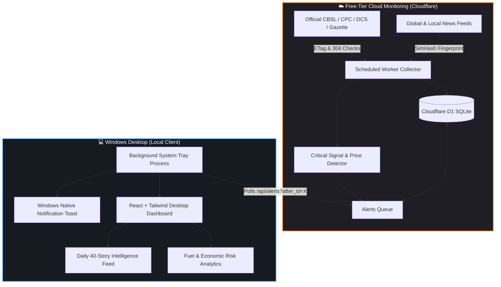

<div align="center">

# ⚡ DoomDesk-AI
### Sri Lanka News Intelligence & Price Prediction System

**A hybrid cloud intelligence platform monitoring Sri Lankan news, market dynamics, and price movements—powered by zero-cost cloud workers and delivered straight to your Windows desktop with native alerts.**

<br/>

[](https://workers.cloudflare.com/)
[](https://developers.cloudflare.com/d1/)
[](https://tauri.app/)
[](https://react.dev/)
[](https://tailwindcss.com/)
[-blue?style=for-the-badge)](https://time.is/Colombo)

<br/>

[Key Architecture](#-hybrid-architecture) •
[Data Sources](#-primary-data-sources) •
[Verification Engine](#-5-question-news-verification-engine) •
[Desktop Dashboard](#-windows-desktop-experience) •
[Quickstart](#-quickstart-guide) •
[Roadmap](#-implementation-roadmap)

---

</div>

## 📌 Executive Summary

**DoomDesk-AI** is designed around a core philosophy: **collect facts, detect events, cross-verify claims across independent sources, and estimate price risks—notifying you only when the evidence justifies it.**

- **Hybrid Cloud Design:** Lightweight Cloudflare Workers monitor internet feeds 24/7 without requiring your personal PC to stay powered on.
- **Windows Desktop Alerting:** A low-memory background tray application pulls alerts via a monotonic integer cursor (`GET /api/alerts?after_id=X`), guaranteeing **at-least-once recovery** with zero duplicate spam even after sleep or laptop restarts.
- **Honest Forecasting:** Predictions are explicitly distinguished from official announcements. Probabilities are calibrated on historical data, never hallucinated by an LLM.

---

## 🏛️ Hybrid Architecture



---

## 🔎 5-Question News Verification Engine

Rather than simply summarizing articles, DoomDesk-AI subjects every critical headline to a multi-source corroboration check:

| # | Verification Step | How It Works |
|---|---|---|
| **1** | **Source Trustworthiness** | Checks publisher identity, track record, and domain reliability score (0-100). |
| **2** | **Multi-Source Corroboration** | Scans independent publishers to check if the same claim is reported elsewhere. |
| **3** | **Anti-Syndication Check** | Groups wire copies (Reuters/AP/AFP) and shared corporate owners so syndicated duplicates are **not** falsely counted as independent confirmations. |
| **4** | **Factual Consistency** | Compares dates, numbers, figures, locations, and pricing quotes. |
| **5** | **Contradiction Detection** | Identifies official denials, retractions, or conflicting price quotes. |

### Visual Verification Badges

```text
 [  VERIFIED  ] Key claims backed by official primary source or multiple independent outlets
 [ PARTIAL-VER] Core event confirmed, but figures, dates, or details remain uncertain
 [ UNVERIFIED ] Breaking news or single-source reporting with no independent corroboration yet
 [ CONFLICTING] Credible sources report contradictory figures or facts
 [CONTRADICTED] Strong primary evidence directly refutes the reported claim
```

> **Fast-Alert Rule:** Breaking critical events are dispatched to your desktop **immediately** marked as `[ UNVERIFIED ]` so you are never left in the dark waiting for corroboration. The alert is seamlessly upgraded once corroborating evidence arrives.

---

## 📊 Economic & Price Forecasting Tiers

DoomDesk-AI tracks key Sri Lankan price drivers across **Energy (Petrol/Diesel/LPG)**, **Essentials (Rice, Sugar, Wheat)**, and **Macro (USD/LKR, Inflation)**.

| Level | Badge | Trigger Condition | Desktop Alert Action |
|---|---|---|---|
| **Confirmed** | <kbd>🟢 CONFIRMED</kbd> | Official Gazette, CPC notice, or CBSL announcement published | **Immediate High-Priority Toast** |
| **Elevated Risk** | <kbd>🟡 ELEVATED RISK</kbd> | Calibrated model + global crude + USD/LKR signals upward price pressure | **Warning Toast with Evidence Links** |
| **Watch** | <kbd>🔵 WATCH</kbd> | Early warning signals detected, but evidence is incomplete | **Dashboard Watchlist Only** |
| **Data Warning** | <kbd>⚪ DATA WARNING</kbd> | Feed stale, source outage, or conflicting data detected | **Status Bar Indicator** |

---

## 💻 Windows Desktop Experience

```text
┌─────────────────────────────────────────────────────────────────────────────┐
│ ⚡ DoomDesk-AI  •  Sri Lanka Intelligence Dashboard       [—] [口] [X]      │
├─────────────────────────────────────────────────────────────────────────────┤
│   Colombo Time: 13:25 SLST (UTC+5:30)  │  Cloud: Connected (Cursor: #142)    │
├────────────────────────┬────────────────────────────────────────────────────┤
│ 🔔 ACTIVE ALERTS (2)   │ 📈 FUEL & COMMODITY RISK MONITOR                   │
│ ────────────────────── │ ────────────────────────────────────────────────── │
│ 🟡 ELEVATED RISK       │ Octane 92 Petrol: Rs. 311.00/L  [Pressure: +4.2%]  │
│ Global crude up +4.5%  │ Auto Diesel:      Rs. 283.00/L  [Pressure: +1.8%]  │
│ USD/LKR: 298.50        │ USD / LKR:        298.50        [Change: +0.12%]   │
│ [View Evidence Links]  │                                                    │
├────────────────────────┴────────────────────────────────────────────────────┤
│ 📰 TODAY'S 40-STORY BRIEFING (10 Sri Lanka • 10 World • 10 Tech • 10 AI)   │
│ ─────────────────────────────────────────────────────────────────────────── │
│ [VERIFIED]   CBSL Maintains Policy Rates in Latest Review      (18m ago)    │
│ [PARTIAL]    Government Reviews Thermal Power Tariffs          (42m ago)    │
│ [UNVERIFIED] Middle East Shipping Rerouting Pressures Freight  (1h ago)     │
└─────────────────────────────────────────────────────────────────────────────┘
```

---

## 🌐 Primary Data Sources

| Source | Category | Retrieval Method | Polling Interval |
|---|---|---|---|
| **[Central Bank of Sri Lanka](https://www.cbsl.gov.lk)** | Exchange Rates, Inflation, Daily Food Prices | API & XML Notices | Every 10 min |
| **[Ceylon Petroleum Corporation](https://ceypetco.gov.lk)** | Official Fuel Prices & Revision History | Structured Extraction | Every 30 min |
| **[Dept. of Census & Statistics](https://www.statistics.gov.lk)** | CCPI Inflation & Retail Price Indices | Official Indicators | Daily |
| **[Government Gazette](https://documents.gov.lk)** | Extraordinary Gazettes, Tariffs & Tax Orders | Notice Monitor | Every 15 min |
| **Local Press (Derana, Mirror, EconomyNext)** | Sri Lankan Business, Politics & Logistics | RSS / Atom Feeds | Every 10 min |
| **Global Energy (Reuters, Brent, EIA)** | Global Crude Oil, Refined Fuel, Supply Lines | Aggregated Feeds | Every 20 min |

---

## 💰 100% Free-Tier Cost Breakdown

| Component | Provider / Tier | Allowance | DoomDesk Usage Budget |
|---|---|---|---|
| **Serverless Workers** | Cloudflare Workers Free | 100,000 requests/day | ~150 cron runs/day (<10ms CPU each) |
| **Relational Database** | Cloudflare D1 (SQLite) | 5M reads / 100k writes/day | ~1,200 writes/day (with ETag/304 skips) |
| **Web Dashboard** | Cloudflare Pages | Unlimited bandwidth & requests | Static React bundle hosting |
| **Desktop App** | Tauri v2 + Rust | Open source / Local | Runs locally on your Windows PC |
| **Total Monthly Cost** | — | — | **$0.00 / month** |

---

## 🚀 Quickstart Guide

### Prerequisites
- **Node.js**: v20+ (`node -v`)
- **npm**: v10+ (`npm -v`)
- **Cloudflare Wrangler CLI**: Included in project devDependencies

### 1. Clone & Setup Worker
```bash
git clone https://github.com/Bijon2002/DoomDesk-Ai.git
cd DoomDesk-Ai/services/worker
npm install
```

### 2. Initialize Local D1 Database
```bash
npm run db:init:local
```

### 3. Run Milestone 0 Source Probe
Verify live connectivity to CBSL, CPC, and Sri Lankan news feeds:
```bash
node ../../scripts/probe.js
```

### 4. Start Local Cloudflare Worker Dev Server
```bash
npm run dev
```

Visit `http://localhost:8787/health` or `http://localhost:8787/api/sources` in your browser.

---

## 📡 API Reference

- `GET /health` — Edge status, UTC & Asia/Colombo timestamps, total article and alert metrics.
- `GET /api/alerts?after_id={cursor}&limit=50` — Monotonic integer cursor recovery for Windows Desktop.
- `POST /api/alerts/test` — Trigger a test alert to verify Windows desktop toast notifications.
- `GET /api/articles?category={sri_lanka|world|tech|ai}&limit=40` — Curated and ranked daily briefing feeds.
- `GET /api/sources` — Active source registry, reliability scores, and check health.
- `GET /api/probe?url={target_url}` — Edge proxy probe testing status, ETag, and latency from Cloudflare.
- `POST /api/collect/run` — Manually trigger a small-batch collector cycle.

---

## 🗺️ Implementation Roadmap

- [x] **M0: Source Probes & Cloudflare Network Validation**
  - Live probe CBSL, CPC, Gazette, DCS, and news feeds for response codes & ETag caching.
- [x] **M1: Cloudflare Worker Ingestion & D1 Setup**
  - D1 SQLite schema (19 tables & indexes), 64-bit SimHash, priority small-batch collector.
- [x] **M2: Alert API with Cursor Pagination**
  - Monotonic integer cursor endpoint (`/api/alerts?after_id=X`) for crash-proof client recovery.
- [ ] **M3: Windows Desktop Application (React + Tauri)**
  - System tray icon, background poll loop (60-120s), native Windows notifications.
- [ ] **M4: News Verification & Anti-Syndication Layer**
  - Cross-publisher corroboration, claim extraction, syndication grouping.
- [ ] **M5: Economic Data Pipeline & CPC Fuel Backfill**
  - Historical fuel revisions backfill, CBSL daily price ingestion, USD/LKR rate tracking.
- [ ] **M6: Forecasting & Risk Engine**
  - Rule-based fuel formula risk calculator, statistical baselines, calibrated alert thresholds.

---

<div align="center">

Built with ❤️ for resilient Sri Lankan market intelligence.  
**Contributions, bug reports, and suggestions are welcome!**

</div>
